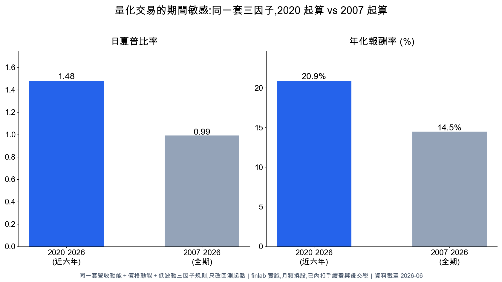
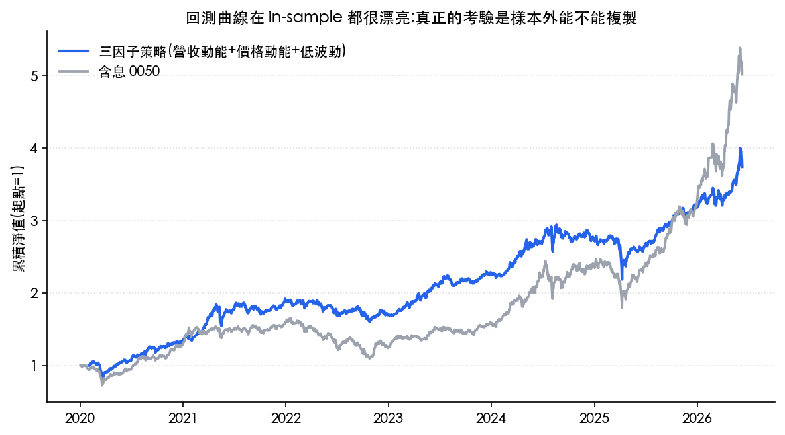
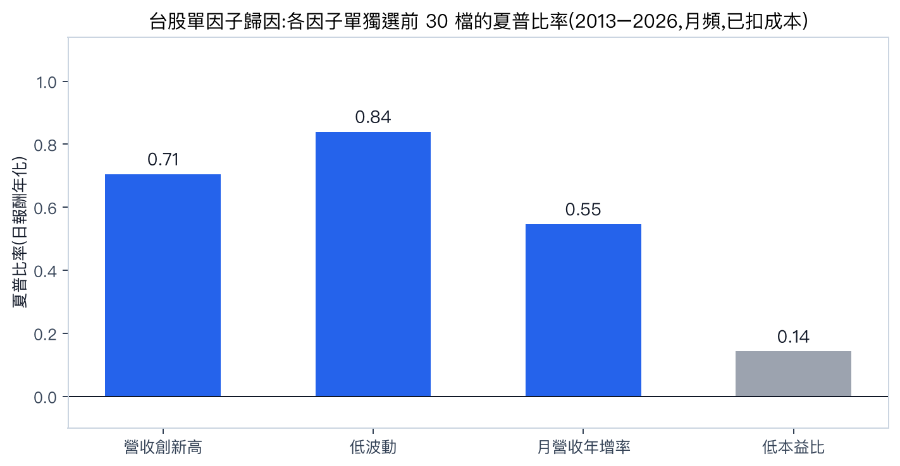
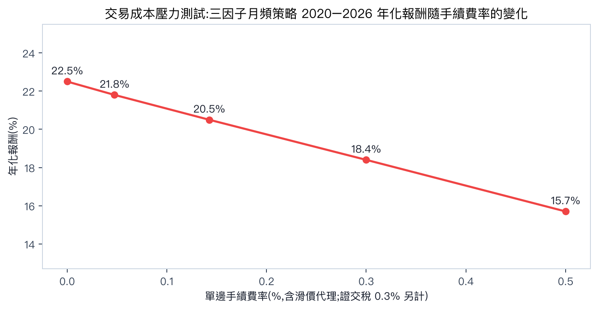
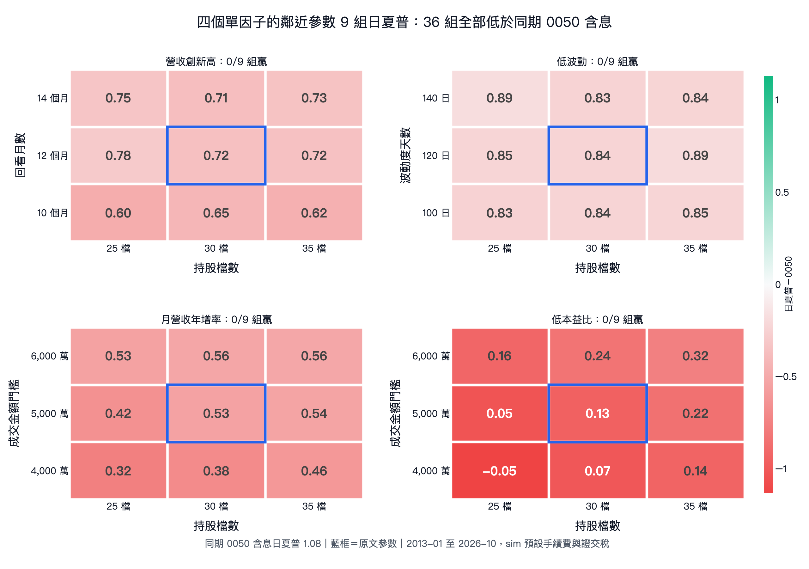

# 量化交易的缺點與風險：FinLab 台股實證整理

> 本文是自行撰寫的閱讀筆記，並非 FinLab 原文或獨立回測報告。數字與圖表均來自[原始文章](https://finlab.finance/blog/quant-trading-disadvantages-risks)，過去績效不代表未來結果。

- 來源：FinLab 量化研究團隊，〈量化交易的缺點與風險有哪些？2026 台股實證：過擬合、期間敏感與成本陷阱〉
- 原文網址：https://finlab.finance/blog/quant-trading-disadvantages-risks
- 原文標示最後更新：2026-10
- 擷取日期：2026-11-02（Asia/Taipei）

## 核心結論

量化交易能把決策寫成可檢查的規則，但回測績效仍可能受到研究方法、資料品質與實際成交條件影響。評估一套策略時，應同時看不同市場期間、含息基準、交易成本、流動性及樣本外表現；單看一條漂亮的歷史曲線，資訊不足。

圖表來源：[FinLab 原文](https://finlab.finance/blog/quant-trading-disadvantages-risks)；圖片檔為原站插圖的本機備份。

## 七類主要風險

| 風險 | 回測可能出現的問題 | 檢查方式 |
| --- | --- | --- |
| 過擬合 | 反覆挑因子、調參數後，選到碰巧適合歷史資料的規則 | 保留未參與研究的樣本外期間，記錄嘗試次數，檢查鄰近參數 |
| 期間敏感 | 只選近年或多頭期間，績效被特定行情墊高 | 比較長期、空頭及震盪期間 |
| 因子失效 | 直覺上合理的選股條件，可能沒有穩定的超額報酬 | 拆開測試各因子，與同期含息基準比較 |
| 成本與滑價 | 換股越頻繁，手續費、稅與成交價偏差越容易侵蝕報酬 | 依實際條件扣成本，對費率和滑價做壓力測試 |
| 流動性與容量 | 歷史價格看似能成交，較大部位卻可能推動市價 | 設成交金額門檻，估算持倉占成交量比例 |
| 資料偏誤 | 漏掉下市股票或提前使用尚未公布的資料 | 納入歷史股票池，以資料實際可得日對齊訊號 |
| 執行紀律 | 回撤時停用或臨時改動規則，實際結果偏離回測 | 事先訂出停用、檢討與風險控管條件 |

## 文章中的台股回測數據

### 同一策略，起始期間不同

FinLab 比較同一套三因子策略的兩段回測。原文報告口徑下，較短期間的夏普及年化報酬都較高：

| 回測期間 | 夏普比率 | 年化報酬 |
| --- | ---: | ---: |
| 2020–2026 | 1.48 | 20.9% |
| 2007–2026 | 0.99 | 14.5% |

這組對照說明，展示績效時必須交代起訖時間。原文後段另以**預設交易成本、未扣無風險利率**的日夏普口徑重算，兩段分別為 **1.53** 與 **1.11**；這兩組夏普不可直接當作相同口徑比較。[原文的口徑說明](https://finlab.finance/blog/quant-trading-disadvantages-risks)

圖表來源：[FinLab 原文](https://finlab.finance/blog/quant-trading-disadvantages-risks)。樣本內淨值曲線只能呈現已知歷史的表現。

### 單因子未勝過同期含息 0050

原文以 2013 年至 2026 年 8 月的台股資料，對每個因子分別做月頻選股回測。以下為該段的夏普比率；因子彼此及 0050 應在同一期間比較。

| 規則 | 夏普比率 |
| --- | ---: |
| 低波動 | 0.84 |
| 營收創新高 | 0.71 |
| 月營收年增率 | 0.55 |
| 低本益比 | 0.14 |
| 含息 0050 買進持有 | 1.08 |

四個單因子在這次測試中都低於基準。這不能推論所有市場或所有參數下單因子都無效，但提醒使用者先查證單一訊號是否真的增加策略品質。

圖表來源：[FinLab 原文](https://finlab.finance/blog/quant-trading-disadvantages-risks)。

### 交易成本會改變結論

原文對月頻三因子策略調高手續費率，並以此代理額外滑價：當設定由 **0%** 升至 **0.5%**，2020 年 1 月至 2026 年 8 月的年化報酬由 **22.5%** 降至 **15.7%**。原文指出這五組情境都另扣賣出證交稅。實際成本仍依券商折扣、交易標的與成交情況而異。

圖表來源：[FinLab 原文](https://finlab.finance/blog/quant-trading-disadvantages-risks)。

### 鄰近參數與跨期驗證

原文在 2026 年 10 月再檢查四個單因子：每個因子各試 9 組鄰近設定，共 **36 組**，在其全期比較中均未超過同期含息 0050 的日夏普 **1.08**。同篇文章也報告：三因子複合策略在其選定的 9 組鄰近設定、前後期比較及預設成本測試中通過指定門檻。這些是原文所述的回測驗證，仍不能保證未來表現。

圖表來源：[FinLab 原文](https://finlab.finance/blog/quant-trading-disadvantages-risks)。

## 實作前的檢查清單

1. 先固定策略規則與比較基準，保留一段未用於調參的資料。
2. 記錄每次研究修改；檢查參數小幅變動後是否仍有相近結果。
3. 讓策略與含息 0050 使用相同期間及清楚標示的夏普口徑。
4. 將手續費、證交稅與滑價納入，測試成本上升後的變化。
5. 檢查歷史股票池、公告可得日、流動性及策略容量。
6. 預先規劃回撤期間的操作與定期複查方式。

## 資料來源與圖片授權

- 文字依 [FinLab 原始文章](https://finlab.finance/blog/quant-trading-disadvantages-risks) 改寫整理；文中數值均為來源文章的回測結果，未在本專案重新計算。
- 上述 5 張圖片均下載自 FinLab 網站，著作權屬原權利人；保留本機檔案供這份筆記離線顯示，對外使用時應遵守原站授權條件。
- 圖片原始位置：[期間敏感](https://r2.finlab.finance/blog/quant-trading-disadvantages-risks/dr-period-sensitivity.png)、[樣本內淨值](https://r2.finlab.finance/blog/quant-trading-disadvantages-risks/dr-insample-equity.png)、[單因子](https://r2.finlab.finance/blog/quant-trading-disadvantages-risks/dr-single-factor-2026-10.png)、[成本測試](https://r2.finlab.finance/blog/quant-trading-disadvantages-risks/dr-cost-erosion-2026-10.png)、[參數驗證](https://r2.finlab.finance/blog/quant-trading-disadvantages-risks/dr-single-factor-validation-2026-10-30.png)。
