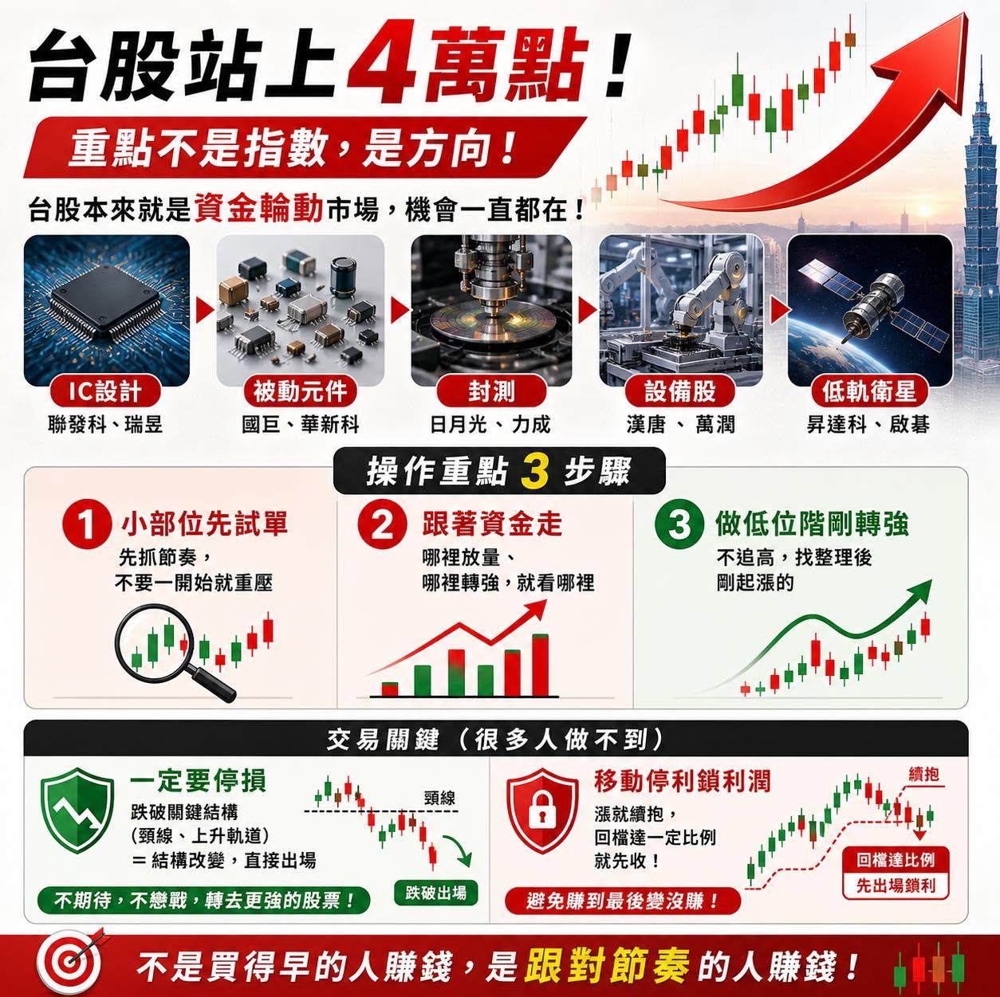

# 楊雲翔：台股資金輪動與交易紀律

台股今天正式站上 4 萬點，再創歷史新高。有些朋友幾個月前覺得資金不夠用，現在看指數越來越高，反而不敢進場。但以現況來說，我不太在意指數。

台股本來就是一個百花齊放的市場，只要資金在，永遠都有機會。重點不是有沒有買在 2 萬點，而是現在有沒有找到對的方向。

我觀察這一波行情，很明顯是資金在輪動：從 IC 設計、被動元件，到封測、設備股，甚至低軌衛星，每一段時間都有不同族群接棒。

## 操作重點

1. **先用小部位測試盤感。** 不要一開始就重壓，先確認自己的節奏有沒有跟上市場。
2. **鎖定資金流向。** 哪個族群開始轉強、量能開始放大，就去看那個族群。
3. **找低位階剛轉強的股票。** 不追已經漲了一段的股票，而是找整理後剛起漲的標的；比較買得下手，勝率也可能更高。

## 停損與停利

停損一定要做。很多人最大的問題是不願意認錯。當型態破掉，例如跌破頸線或上升軌道，代表結構改變，我就會出場。不要期待它一定會回來；停損後轉去更強的股票，很多時候反而有更好的收益。

短線操作也要有停利紀律。賺到一定幅度後，可以用「移動停利」鎖住利潤。假設已經有一段獲利，當股價從高點回檔一定比例，就先出場；如果繼續漲，就續抱，避免最後把獲利還回去。

現階段就算指數在高檔，只要抓到節奏，一樣可以找到機會。市場永遠都在，重點是用什麼方式參與。

## 交易紀律的養成

我今天在節目上分享了大徒弟的交易進化過程。十年前，她還靠聽消息操作，把在股市賺錢想得很輕鬆，結果賠得很慘。

後來，她慢慢建立方法與紀律，從小資金開始做，尤其停損迅速果斷，穩定了好幾年，只缺爆發性。到現在單月獲利可以到千萬，這不是什麼奇蹟，而是紀律帶她一步一步走到現在。

上個月我分享了兩篇大徒弟四月的交易狀況，留言區直接變成大型徒弟報名現場。其實她一開始不是來跟我學股票的。當初我經常在大陸，請她在台灣幫忙處理一些程式管理工作；後來她發現我做股票有一套自己的邏輯，就越問越多、越挖越深。

很多我現在分享的觀念，甚至課程裡的一些細節，都是被她「問」出來的。如果你有興趣學習，小編會在粉絲專頁留言區放上目前的線上課程，可以看看內容是否符合自己的需求；課程內容和我教她的一樣。
