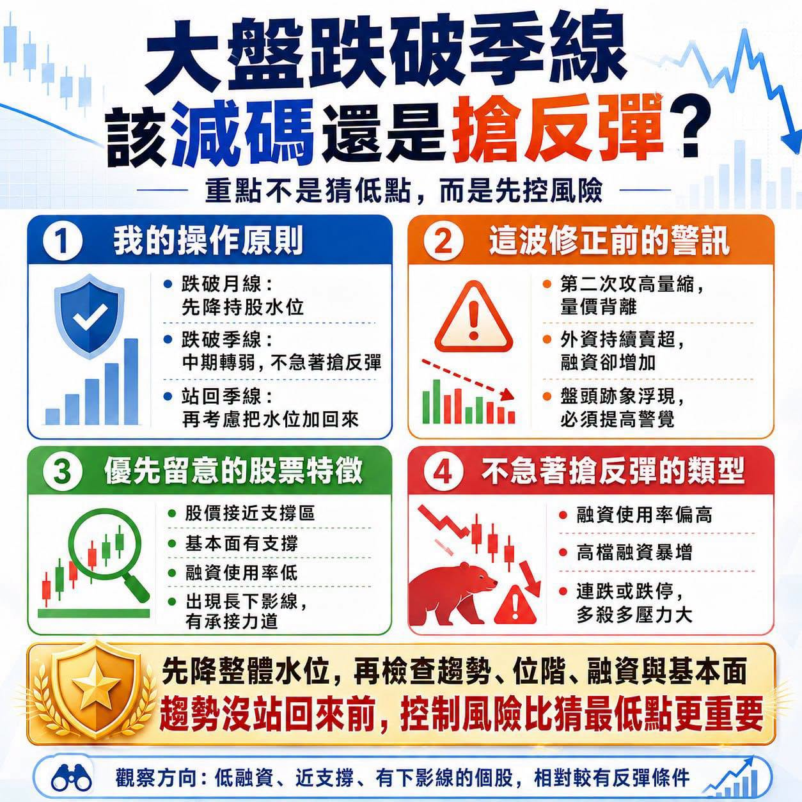

# 楊雲翔：大盤跌破季線後，該減碼還是搶反彈？

## 跌破季線後，先降低持股水位

我的操作方式一直是順勢交易。

大盤跌破月線，我會先降低持股水位；跌破季線，代表中期趨勢明顯轉弱。等到指數重新站回季線，趨勢出現改善，我才會考慮把水位加回來。

## 這波修正前的警訊

這一波修正之前，市場其實已經出現幾個警訊。

指數第二次挑戰高點時，成交量不但沒有增加，反而持續萎縮，形成量價背離。另一方面，外資持續賣超，融資餘額卻不斷增加，代表外資撤退時，散戶仍在高檔接手。

外資賣、融資買、成交量縮，技術型態又有盤頭跡象，這種結構本來就必須提高警覺。

## 檢查個股的支撐、基本面與融資

現在大盤跌破季線，我不會完全沒有持股，但會慎重檢查庫存，把資金放置在相對安全的標的。

所謂的安全，不是保證不會下跌（誰能保證呢），而是股價距離底部較近、基本面有支撐、融資使用率偏低，沒有太大的融資斷頭壓力。

例如部分低本益比、高殖利率，或仍維持上升軌道的公司，即使大盤修正，股價相對抗跌。這些股票過去可能被嫌漲得慢，但市場劇烈震盪時，反而可能成為資金的避風港。

檢查股票時，不能只看融資維持率，還要搭配融資使用率。

融資維持率看起來還很高，不代表股票沒有風險。因為維持率是所有融資部位的平均值，如果大量融資集中在近期高檔，股價一旦快速下跌，這些新增融資仍可能陸續面臨追繳與斷頭。

當一檔股票的融資使用率接近兩成、三成，甚至超過四成，股價又出現連續跌停，就要特別小心多殺多的壓力。

融資水位偏高、近期融資大量增加的股票，即使跌幅已經很深，我也不會急著搶反彈。股價看起來便宜，不代表賣壓已經結束。

相反地，融資使用率低、股價回到長期支撐區，又出現長下影線的股票，代表低檔開始出現承接力道，搶反彈的安全性會相對高一些。

## 個股觀察

以臺慶科來說，股價已經回到較大的支撐區，盤中也出現下影線，基本面仍有營收及獲利支撐。若以弱勢反彈的角度觀察，可以留意反彈至季線附近時可能面臨的壓力。

台光電的融資使用率很低，即使股價跌破季線，也比較沒有融資斷頭造成的急殺賣壓。中美晶與環球晶的籌碼結構也相對穩定，若拉回重要均線附近，可以再觀察是否出現承接。

合晶的情況就不同。前段漲勢較急，融資使用率又超過四成，高檔套牢融資較多，目前融資才剛開始下降，代表多殺多的壓力有可能還沒有完全釋放。

國巨雖然融資不算高，但前波漲幅很大，持股者除了融資壓力，也可能因為擔心獲利全部回吐而賣出。這種股票不適合在跌停時急著接，至少要等跌停打開、出現長下影線，確認第一隻腳的位置後再判斷。

## 控制風險比猜最低點重要

大盤跌破季線，不代表所有股票都要砍在最低點，也不代表每一檔大跌的股票都能搶反彈。

先降低整體水位，再檢查個股的趨勢、股價位階、融資使用率、融資維持率與基本面。趨勢沒有站回來之前，控制風險永遠比猜最低點重要。
